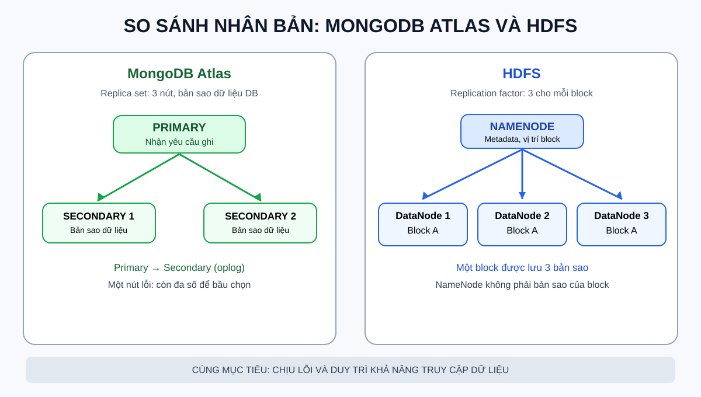

# BÁO CÁO THỰC HÀNH BÀI 3
**Môn:** Điện toán đám mây / Lưu trữ phân tán

**Sinh viên:** [Điền họ tên]  
**MSSV:** [Điền MSSV]  
**Repository:** https://github.com/bishadow27/tdmu-cloud-lab

## 1. Mô hình triển khai
API Express 5 trên Node.js kết nối MongoDB Atlas (cơ sở dữ liệu notes); tệp được tải lên bucket public attachments của Supabase Storage và MongoDB chỉ lưu attachmentUrl.

## 2. Minh chứng kiểm thử API
Chạy `npm run smoke` sau khi `npm start` và chụp màn hình. Ghi kết quả thật vào bảng:

| Tình huống | Mã HTTP mong đợi | Kết quả thực tế |
|---|---:|---|
| POST /notes | 201 | [Điền] |
| GET /notes và GET /notes/:id | 200 | [Điền] |
| PUT /notes/:id | 200 | [Điền] |
| DELETE /notes/:id | 204 | [Điền] |
| GET ghi chú đã xóa | 404 | [Điền] |
| Thiếu title / id sai | 400 | [Điền] |
| POST /notes/:id/attachment | 200 | [Điền] |
| Mở attachmentUrl | 200 | [Điền] |

## 3. Kết quả đo chỉ mục
Chạy `npm run seed` rồi `npm run explain`; chụp **đúng kết quả trên terminal của bạn**.

| Phương pháp | docsExamined | nReturned | executionTimeMillis |
|---|---:|---:|---:|
| COLLSCAN (hint $natural) | [Điền] | [Điền] | [Điền] |
| IXSCAN (hint tags:1) | [Điền] | [Điền] | [Điền] |

**Tỉ số giảm số tài liệu phải kiểm tra:** `[docsExamined của COLLSCAN] / [docsExamined của IXSCAN]` = [Điền] lần.

Không kết luận tốc độ thực tế chỉ dựa vào số ms của 2.000 tài liệu vì chênh lệch nhỏ và có nhiễu; tập trung vào docsExamined và độ chọn lọc của nhãn docker.

## 4. Trả lời câu hỏi phản biện

**Câu 1.** Nếu tỉ lệ tài liệu có tag docker giữ nguyên, với 2 triệu tài liệu, COLLSCAN có thể phải kiểm tra gần 2 triệu tài liệu; IXSCAN chỉ cần kiểm tra khoảng số tài liệu phù hợp (ước lượng bằng tỉ lệ đo được ở mục 3). Số lần giảm gần giữ nguyên nếu phân bố dữ liệu tương tự. Giới hạn 100 thao tác/giây là giới hạn mức yêu cầu đọc/ghi của Atlas Free, **không có nghĩa** quét 2 triệu tài liệu được tính thành 2 triệu thao tác API. Truy vấn nặng vẫn dùng nhiều tài nguyên và có thể làm giảm thông lượng thực tế.

**Câu 2.** Supabase Storage phục vụ tệp qua URL riêng, phù hợp việc lưu và phân phối đối tượng; MongoDB chỉ cần giữ metadata và URL nên tài liệu gọn, truy vấn/tạo chỉ mục thuận tiện. Dù MongoDB có thể lưu nhị phân (BSON có giới hạn kích thước tài liệu, GridFS dành cho tệp lớn), ở bài này tách tệp khỏi tài liệu sẽ đơn giản hơn. Bucket public chỉ nên chứa dữ liệu mẫu, không dùng cho dữ liệu nhạy cảm.

**Câu 3.** Cùng là tạo bản sao để chịu lỗi và tăng độ sẵn sàng. Atlas nhân bản dữ liệu của một tập bản sao cơ sở dữ liệu trên primary/secondary; HDFS nhân bản từng block của tệp ở các DataNode. NameNode quản lý metadata, không giống primary MongoDB.

## 5. Ảnh cần chèn trước khi nộp
- [ ] Ảnh terminal `npm run smoke` có kết quả PASS.
- [ ] Ảnh terminal `npm run explain` có bảng docsExamined.
- [ ] Ảnh Atlas Overview / Metrics thể hiện cụm 3 nút.
- [ ] Ảnh bucket `attachments` chứa `note.txt` và URL truy cập.
- [ ] Ảnh `git status` không có `.env` và ảnh commit `Bai 3`.

**Lưu ý:** Chưa thể tự điền các mục số liệu và ảnh vì chúng phải xuất phát từ Atlas/Supabase do sinh viên tạo.
