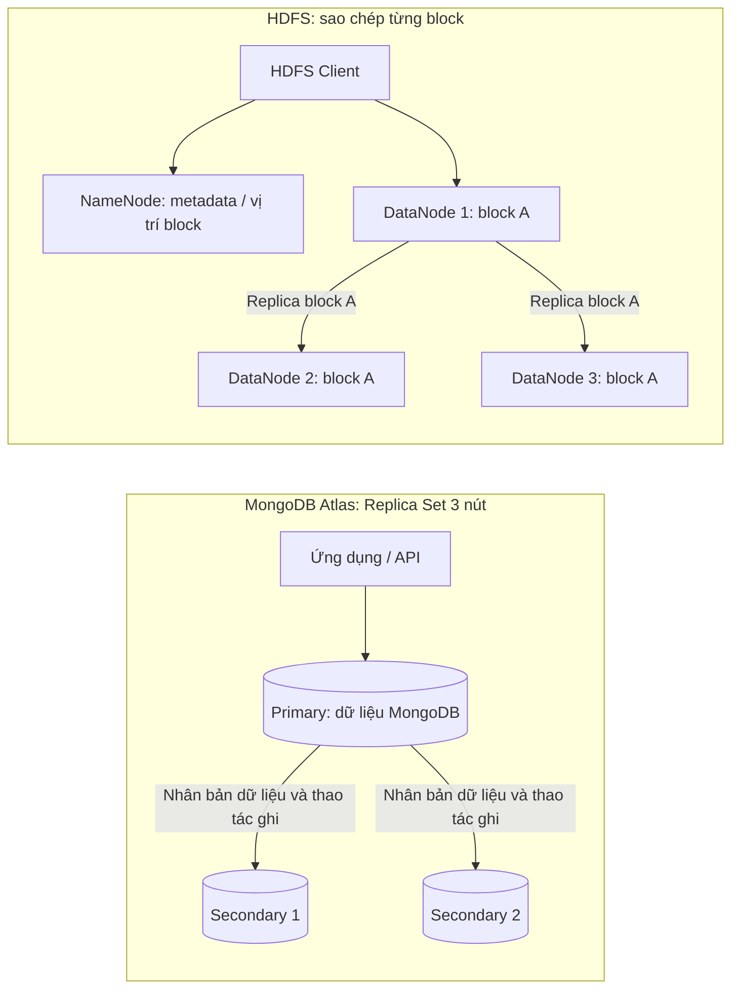

# Sơ đồ so sánh MongoDB Atlas và HDFS

## Điểm giống và khác

| Tiêu chí | MongoDB Atlas | HDFS |
|---|---|---|
| Mục tiêu | Duy trì dữ liệu và sẵn sàng khi một nút lỗi | Bảo vệ khối dữ liệu khi DataNode lỗi |
| Đơn vị nhân bản | Bản sao dữ liệu của replica set, thay đổi được truyền qua oplog | Block của tệp (ví dụ một tệp có thể chia thành nhiều block) |
| Phối hợp | Primary nhận ghi, secondaries áp dụng thay đổi; bầu primary mới khi cần | NameNode giữ metadata; DataNode lưu và sao chép block |
| Số 3 | Atlas Free có replication factor cố định 3 nút | HDFS thường dùng replication factor = 3 cho từng block |
| Khi lỗi một nút | Cụm có thể tiếp tục phục vụ sau bầu cử nếu còn đa số | Các block còn bản sao trên DataNode khác |

**Chú ý:** NameNode của HDFS không tương đương Primary trong Atlas: NameNode quản lý metadata, còn Primary là máy chủ cơ sở dữ liệu xử lý ghi.

Nguồn tham khảo: https://www.mongodb.com/docs/atlas/reference/free-shared-limitations/ và https://hadoop.apache.org/docs/stable/hadoop-project-dist/hadoop-hdfs/HdfsDesign.html
